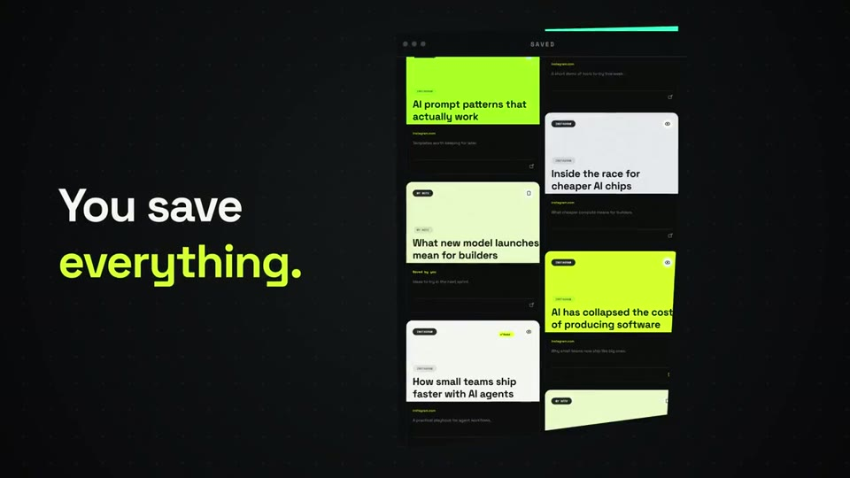

# Remember

**A home for the things you meant to come back to.**

Remember brings saved posts, useful links, screenshots, notes, and imported collections into one personal library. Keep the original source beside the reason you saved it, then search when you need it again.

[](https://rembr-web.onrender.com/launch-film.mp4)

**▶ [Watch the 92-second launch film](https://rembr-web.onrender.com/launch-film.mp4)**

## What you can do

- **Bring your saves together.** Add a public link, a note, an image, or an export of saved posts from Instagram, Pinterest, and X.
- **Keep the context.** Add notes, tags, and collections so a bookmark still makes sense months later.
- **Find things again.** Search your library by what an item is about, where it came from, or why you saved it.
- **Make sense of a growing library.** Optional AI tools can help summarize and describe saved items, find related material, and answer questions about your own library.
- **Stay in control.** Review and manage your saves in your account. Provider-backed features are only available when their server-side credentials are configured.

## How it works

1. **Add something worth keeping.** Paste a public page link, upload an export or image, or write a note.
2. **Remember processes it.** The API checks and records the request. Longer work, such as imports and page capture, moves through durable jobs handled by a separate worker.
3. **Your library keeps the useful parts together.** Items retain their source and any notes, tags, collections, or generated context you choose to keep.
4. **Search when you need it.** Look through your library directly, or use the optional knowledge tools when their providers are set up.

Page access varies. Some sites limit what can be collected, and Remember does not bypass sign-in or paywalls. You can still keep a link, add your own context, and return to the original source.

## Run it locally

### You will need

- Node.js 22.13 or newer
- npm 10 or newer
- A reachable PostgreSQL database with the migrations in `supabase/migrations/` applied

### Start the app

```bash
npm ci
```

Copy `.env.example` to `.env` and set `DATABASE_URL` to your PostgreSQL connection string. The default `STORAGE_BACKEND=local` keeps uploaded files in the local `data/` directories while you develop. Apply the SQL migrations in `supabase/migrations/` to your database before starting the app.

Start the API and web app:

```bash
npm run dev
```

In a second terminal, start the background worker:

```bash
npm run worker
```

Open [http://127.0.0.1:5173](http://127.0.0.1:5173). The API listens on port `4000` by default, and the web development server forwards `/api` requests to it.

## Configuration

The root `.env.example` shows the server-side settings. Most integrations are optional. `VITE_CONTACT_EMAIL` is read by the web build.

| Variable | When you need it |
| --- | --- |
| `DATABASE_URL` | Required. PostgreSQL connection used by the API and worker. |
| `API_PORT` | Optional. API port; defaults to `4000`. |
| `WEB_ORIGIN` | Optional. Allowed web origin; defaults to the local web server. |
| `STORAGE_BACKEND` | Optional. Use `local` for development or `supabase` for Supabase Storage. |
| `SUPABASE_URL` and `SUPABASE_SERVICE_ROLE_KEY` | Required when `STORAGE_BACKEND=supabase`. Keep the service key on the server. |
| `META_API_KEY` | Optional. Enables provider-backed analysis features. |
| `OPENROUTER_API_KEY` | Optional. Enables configured semantic search and web search features. |
| `OPENROUTER_WEB_SEARCH_MODEL` | Optional. Model name for web search; defaults to `openai/gpt-4.1-mini`. |
| `WORKOS_API_KEY`, `WORKOS_AUTHKIT_DOMAIN`, `MCP_RESOURCE_URL` | Optional. Configure all three to enable the MCP sign-in flow. |
| `AI_WORKER_CONCURRENCY` | Optional. Concurrent AI jobs; defaults to `2` and allows values from `1` to `4`. |
| `FFMPEG_PATH` | Optional. Path to FFmpeg for video speech-audio extraction on the worker. |
| `SUPABASE_ASSET_BUCKET`, `SUPABASE_IMPORT_BUCKET`, `SUPABASE_MEDIA_BUCKET` | Optional. Storage bucket names when using Supabase Storage. |
| `ASSET_DIRECTORY`, `IMPORT_DIRECTORY`, `MEDIA_DIRECTORY` | Optional. Local storage folders; default to subdirectories under `data/`. |
| `MAX_CAPTURE_BYTES`, `MAX_CAPTURE_REDIRECTS` | Optional. Limits for public-page capture; defaults are 2 MiB and 3 redirects. |
| `SERVE_WEB`, `WEB_BUILD_DIRECTORY` | Optional. Serve the built web app from the API in a production deployment. |
| `REMBR_DEMO_OWNER_ID` | Optional. Enables the demo sign-in route for the configured account. |
| `VITE_CONTACT_EMAIL` | Optional. Set in the web app environment to add the public contact destination to the build. |

Do not commit `.env` files, provider credentials, or service-role keys. The browser talks to the API; database and provider credentials stay on the server.

## Project layout

```text
apps/
  api/       Express API, account and library routes, processing jobs, worker
  web/       React app and public pages
    public/  Public site assets, including the launch film and poster
supabase/
  migrations/ PostgreSQL schema changes
data/        Local uploads and media during development
```

The API owns account access, library changes, imports, and job creation. The worker picks up queued work and records its progress for the app to show. PostgreSQL stores application data; files use local storage in development or Supabase Storage when configured.

## Commands

| Command | What it does |
| --- | --- |
| `npm run dev` | Starts the API and web development server. |
| `npm run worker` | Starts the background worker. |
| `npm run typecheck` | Checks the TypeScript workspaces. |
| `npm run lint` | Lints the API and web workspaces. |
| `npm test` | Runs the API test suite. |
| `npm run build` | Builds the API and web app. |
| `npm run check` | Runs typecheck, lint, tests, and builds. |

## Deployment

`render.yaml` describes a web service and a separate background worker. Both need the same database and storage configuration. Add production credentials through the host's secret environment settings, apply pending SQL migrations before relying on a release, and check the health endpoint at `/api/health` after deployment.

## A note on imported and generated content

Remember keeps links to original sources so you can open them again. Summaries and other generated details are helpers; check the saved item and source when accuracy matters. Provider-backed tools require their corresponding credentials and may not be available in a local setup.
