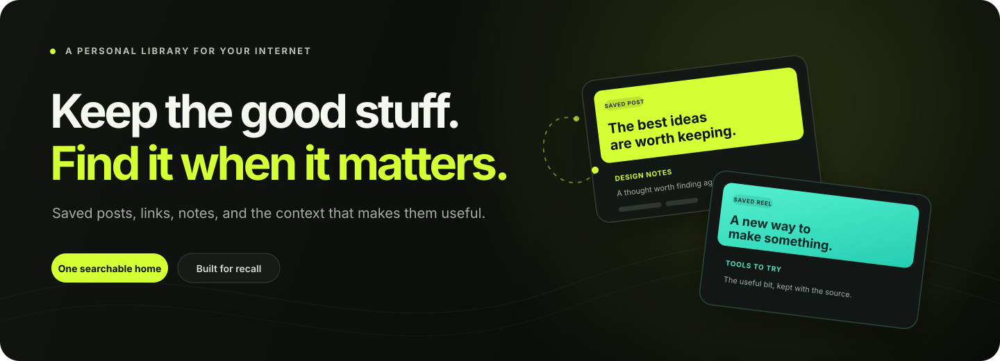

<p align="center">
  
</p>

<p align="center">
  <a href="https://rembr-web.onrender.com/launch-film.mp4"></a>
</p>

<p align="center">
  <a href="https://rembr-web.onrender.com/">Open Rembr</a>
  &nbsp;·&nbsp;
  <a href="https://rembr-web.onrender.com/launch-film.mp4">Watch the launch film</a>
  &nbsp;·&nbsp;
  <a href="#run-locally">Run locally</a>
</p>

<p align="center">A personal library for saved posts, links, images, and the context that makes them useful.</p>

## Keep what caught your attention

Good ideas arrive everywhere. Rembr brings saved posts, useful links, screenshots, and notes into one searchable library, with their source and your reason for saving them close at hand.

| Save | Remember | Find |
| --- | --- | --- |
| Bring in a public link, a note, an image, or an export from Instagram, Pinterest, and X. | Keep notes, tags, collections, and generated context with each item. | Search by topic, source, or the reason you saved it. Ask questions about your library with optional AI tools. |

Rembr keeps the link to the original source so you can return to it. Some sites limit what can be collected; Rembr does not bypass sign-in or paywalls.

## Run locally

### Requirements

- Node.js 22.13 or newer
- npm 10 or newer
- PostgreSQL, with the SQL migrations in `supabase/migrations/` applied

### Start

```bash
npm ci
```

Copy `.env.example` to `.env` and set `DATABASE_URL`. The default `STORAGE_BACKEND=local` stores uploaded files under `data/` during development.

Start the API and web app:

```bash
npm run dev
```

In a second terminal, start the worker:

```bash
npm run worker
```

Open [http://127.0.0.1:5173](http://127.0.0.1:5173). The API listens on port `4000` by default, and the web development server forwards `/api` requests to it.

## Configuration

The root `.env.example` lists available settings. The minimum local setup needs `DATABASE_URL`. Most integrations are optional; for example, configure `META_API_KEY` for provider-backed analysis, `OPENROUTER_API_KEY` for semantic and web search, and Supabase settings when using Supabase Storage.

Keep database credentials, provider keys, and the Supabase service role key on the server. Do not commit `.env` files or secrets.

## How it works

The web app sends requests to the API, which owns account access, library updates, imports, and job creation. Longer tasks run in a separate worker and report progress back to the app. PostgreSQL stores application data; uploaded files use local storage in development or Supabase Storage when configured.

```text
apps/
  api/       Express API, library routes, processing jobs, and worker
  web/       React app and public pages
    public/  Brand assets, launch film, and README artwork
supabase/
  migrations/ PostgreSQL schema changes
data/        Local uploads and media during development
```

## Useful commands

| Command | Purpose |
| --- | --- |
| `npm run dev` | Start the API and web development server. |
| `npm run worker` | Start the background worker. |
| `npm run typecheck` | Typecheck the workspaces. |
| `npm run lint` | Lint the API and web workspaces. |
| `npm test` | Run the API test suite. |
| `npm run build` | Build the API and web app. |
| `npm run check` | Run typecheck, lint, tests, and builds. |

## Deployment

[`render.yaml`](render.yaml) describes a web service and a separate background worker. Both need the same database and storage configuration. Add production credentials through the host's secret environment settings, apply pending SQL migrations before relying on a release, and check `/api/health` after deployment.

## Imported and generated content

Summaries and other generated details are helpers. Check the saved item and its source when accuracy matters. Provider-backed tools require their corresponding credentials and may not be available in a local setup.
