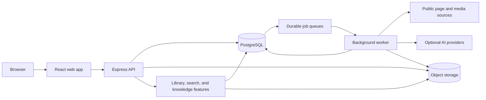

<p align="center">
  
</p>

<p align="center">
  <a href="https://rembr-web.onrender.com/launch-film.mp4"></a>
</p>

<p align="center">
  <a href="https://rembr-web.onrender.com/">Open Rembr</a>
  &nbsp;·&nbsp;
  <a href="https://rembr-web.onrender.com/launch-film.mp4">Watch the launch film</a>
  &nbsp;·&nbsp;
  <a href="#run-locally">Run locally</a>
</p>

<p align="center">A personal library for saved posts, links, images, and the context that makes them useful.</p>

## A library built for remembering

Rembr brings things you want to come back to into one searchable place. Keep the original source alongside your notes and extracted context, then use search and knowledge tools to make a growing collection useful again.

## Features

### Save from different places

- Save a public page by URL, or write a note and attach images.
- Import supported saves from Instagram, Pinterest, and X exports.
- See import and processing progress, and retry or reprocess supported work when needed.
- Keep the original URL so a saved item can lead back to its source.

### Add useful context

- Edit titles and descriptions, add notes, apply tags, and organize items in collections.
- Build Smart Collections that refresh in the background as your library changes.
- On supported public pages, capture page metadata, readable text, and available media details.
- When enabled, AI analysis can summarize items and describe supported images or video, including on-screen text and speech transcripts.

### Search and explore

- Search the library by words, titles, source, tags, and saved context.
- Enable semantic search to find related ideas even when your query uses different words.
- Use optional visual search to look for saved items related to an image.
- Ask questions about your saved library and inspect the saved items used as evidence.
- Switch to optional web search when you need current information beyond your own library.

### Turn saves into a knowledge base

- Explore a knowledge graph connecting saved items through topics, domains, and entities.
- Export graph content to JSON or an Obsidian archive.
- Use optional recall prompts for items you chose to remember.
- Check saved links and create reminders to revisit useful items.

### Connect your tools

- Use the owner-scoped REST API for personal integrations.
- Connect compatible clients through the optional WorkOS-authenticated MCP interface.

AI, semantic search, visual search, and web search depend on server-side providers. Meta powers configured content analysis and visual search; OpenRouter powers semantic embeddings and web search. AI processing and AI-assisted search are optional and governed by the preferences shown in the app. When providers are unavailable, core library features remain available.

## How it works

1. **Capture.** The web app sends a page URL, note, image, or import to the API. The API validates the request, scopes it to the signed-in owner, and checks public URLs before fetching them.
2. **Queue.** The API stores the saved item and creates durable processing work in PostgreSQL. The web app can show whether the item is queued, processing, ready, or needs attention.
3. **Extract.** A background worker claims queued jobs, reads supported public page content, and records extracted text and available media artifacts. Imports are parsed and accepted as a separate job flow.
4. **Enrich when enabled.** Separate AI jobs can analyze supported text and media when the owner has enabled the feature and a provider is configured. Generated results are stored alongside the source item.
5. **Find and use.** The library combines saved content, notes, tags, collections, and generated context for search and knowledge tools. Answers about the library identify the saved items they use.

Some sites restrict automated page access or expose little public content. Rembr does not bypass sign-in or paywalls; in those cases, the URL and any context you add can still be saved.

## Architecture



### Main components

| Component | Responsibility |
| --- | --- |
| **Web app** | React and TypeScript interface for the library, saved-item details, imports, search, and knowledge tools. Vite serves it during development; the API can serve the production build. |
| **API** | TypeScript and Express endpoints for authentication, profiles, saves, notes, imports, organization, search, and knowledge features. It validates inputs and enforces owner-scoped access. |
| **Background worker** | Processes page capture, imports, media analysis, and other queued jobs. Jobs have durable status and retry handling so longer work does not depend on a browser request staying open. |
| **PostgreSQL** | Stores accounts, saved items, extracted artifacts, notes, tags, collections, processing state, search data, and knowledge features. Schema changes live in `supabase/migrations/`. |
| **Object storage** | Stores uploaded images, import files, and media artifacts through a storage adapter. Local storage is available for development; Supabase Storage is configured for hosted use. |
| **AI providers** | Optional server-side integrations for analysis, embeddings, visual search, and web search. Provider credentials stay on the server. |

### Data boundaries

- The API and worker share the database and storage adapters; the browser never receives database credentials or provider keys.
- Saved items, notes, imports, and search results are scoped to their owner.
- AI processing and search features are optional. Their provider-dependent behavior is unavailable when configuration or required consent is missing.
- Captured and generated descriptions are aids for finding and understanding an item. The original saved item remains the source to check when accuracy matters.

## Technology

- **Web:** React, TypeScript, Vite, Tailwind CSS
- **API and jobs:** Node.js, Express, TypeScript
- **Database:** PostgreSQL
- **Hosted object storage:** Supabase Storage, behind a storage adapter
- **Deployment:** Render web service and separate background worker
- **Optional AI services:** Meta and OpenRouter integrations, configured on the server

## Run locally

You will need Node.js 22.13 or newer, npm, and a reachable PostgreSQL database with the migrations in `supabase/migrations/` applied.

```bash
npm ci
```

Copy `.env.example` to `.env`, set `DATABASE_URL`, then run `npm run dev` and `npm run worker` in separate terminals. Open [http://127.0.0.1:5173](http://127.0.0.1:5173). Local storage is the default; provider integrations are optional.

| Command | Purpose |
| --- | --- |
| `npm run dev` | Start the API and web development server. |
| `npm run worker` | Start background processing. |
| `npm run typecheck` | Typecheck the workspaces. |
| `npm run lint` | Lint the API and web workspaces. |
| `npm test` | Run the API test suite. |
| `npm run build` | Build the API and web app. |

## Project layout

```text
apps/
  api/src/       Express routes, domain services, storage, and worker
  web/src/       React application and product features
  web/public/    Brand assets, launch film, and public artwork
supabase/
  migrations/    PostgreSQL schema changes
```

## Deployment

[`render.yaml`](render.yaml) describes the hosted API/web service and background worker. Configure the same database and storage settings for both services, add provider credentials only through server-side secret settings, and apply pending SQL migrations before relying on a release. The API health endpoint is `/api/health`.

## Content and integrations

Page access varies by source, and some platforms provide only partial public metadata. Rembr stores links to original sources; imported and generated details can be incomplete. Review the source when accuracy matters. Provider-backed capabilities require their corresponding credentials and may not be available in a local setup.
