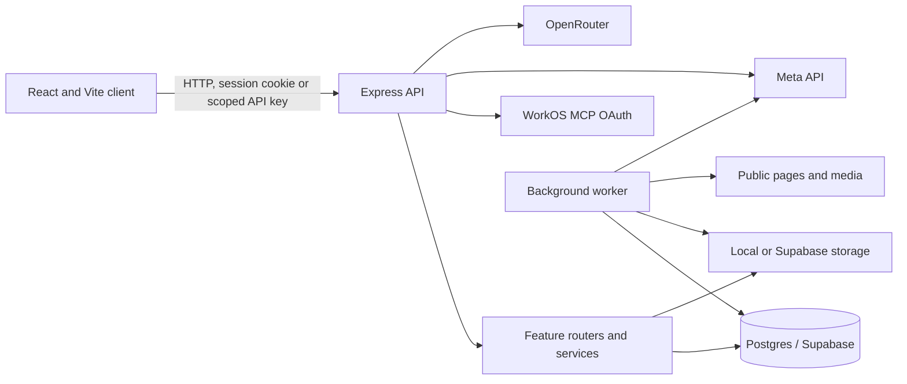

# Architecture map

## Verified structure and runtime

- Node 22+ npm workspace monorepo (`package.json`) contains `apps/api` (Express 5, TypeScript, Postgres/PGlite test harness) and `apps/web` (React 19, React Router 7, Vite 8, Tailwind 4).
- API boot: `apps/api/src/index.ts` initializes DB, storage adapters, asset recovery, HTTP server/shutdown; `apps/api/src/app.ts` installs middleware and mounts split route modules.
- Web boot: `apps/web/src/main.tsx`; `App.tsx` handles route/lazy-loaded surfaces, `app/` holds API client/contracts and shared state, `features/` groups auth, imports, integrations, items, knowledge, library, organization, settings, workspace and marketing.
- Worker boot: `apps/api/src/worker/index.ts`; job lifecycle/claims and page/media processing in `apps/api/src/worker/process-job.ts`; serial import processing and configured AI concurrency.
- Data: Postgres via `DatabaseHandle` and Supabase in production; PGlite for tests. Schema history under `supabase/migrations`. Storage chooses local or Supabase adapters. Hosted RLS/grants were not inspected.
- External services visible in code/config: Supabase/Postgres and object storage, Meta API, OpenRouter, WorkOS MCP/OAuth. No external provider was contacted.
- Deployment config: Render web + Docker worker, both configured to deploy commits from `master`; web serves the built Vite app and `/api/health`. `render.yaml` uses 0.5 CPU/512 MB plans and `sync:false` for credentials. This is config evidence only, not proof of live state.
- API inventory: 72 route declarations across auth, account, library, imports, jobs, AI, knowledge, collections, organization, integrations, MCP, and health routes; routes are split by domain. Review coverage limits are listed in `13-security.md`.

## Verified request/data flow

Browser calls are centralized under `apps/web/src/app`. Express applies security/CORS/request parsing and request IDs, then session/API-key middleware and feature routers. Feature services use owner-scoped repository queries and the DB abstraction. User saves/imports enqueue processing rows; worker claims lease tokens, fetches validated public content, stores extraction/media and updates item/job/import state transactionally. External integrations are controlled by configuration and consent/preferences where relevant.

## Limits

This architecture map is cross-referenced with repo manifests, routes, render config and focused source review. Not every one of 69 API source files or 67 web source files was reviewed line by line. Hosted DB policy/grant state, deployed versions, browser runtime, and provider configuration remain unknown.
