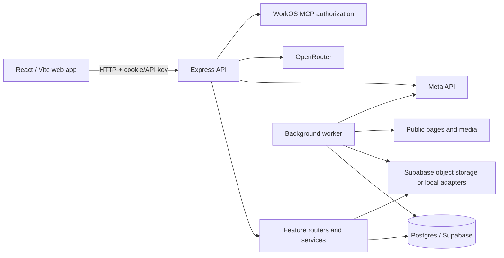

# Architecture map (API and worker review)

## Verified structure

- `apps/web/src/main.tsx` boots the React/Vite client; `App.tsx` and feature modules under `apps/web/src/features` compose the product UI. API calls/contracts are centralized under `apps/web/src/app`.
- `apps/api/src/index.ts` constructs the database and storage adapters, performs asset recovery, mounts the Express app, and owns HTTP shutdown.
- `apps/api/src/app.ts` configures Helmet, request IDs, origin checks/CORS, bounded JSON parsing, health/auth endpoints, and feature routers. Routers are split across account, library, organization, imports, jobs, AI, knowledge, Smart Collections, and integrations.
- API services use a `DatabaseHandle` abstraction (`apps/api/src/db/database.ts`) that adapts SQL placeholders and transaction handling. Runtime database config is Postgres; tests use PGlite (see app package and database tests).
- The worker entry (`apps/api/src/worker/index.ts`) serially handles import/application jobs and runs a configurable pool of AI workers. `process-job.ts` claims work with a lease token, fetches public pages/media, persists extraction and job state, and retries transient failures.
- Storage adapters cover Supabase object storage and local storage; storage adapter selection is in `apps/api/src/storage/adapters.ts`. External integrations include Meta API, OpenRouter, WorkOS MCP OAuth, and Supabase/Postgres, based on imports and configuration. Their hosted state was not inspected.
- Database schema is maintained by `supabase/migrations`; RLS and policy inventory were not fully reviewed in this architecture pass.

## Coverage

Reviewed API composition, worker job flow, database transaction wrapper, workspace manifests, and source-path inventory. This file is not a complete line-by-line architecture inventory of all 182 API source files or all web modules. Endpoint authorization, RLS, frontend behavior, performance, and provider configuration are assigned to separate audit passes. No hosted services were contacted.
