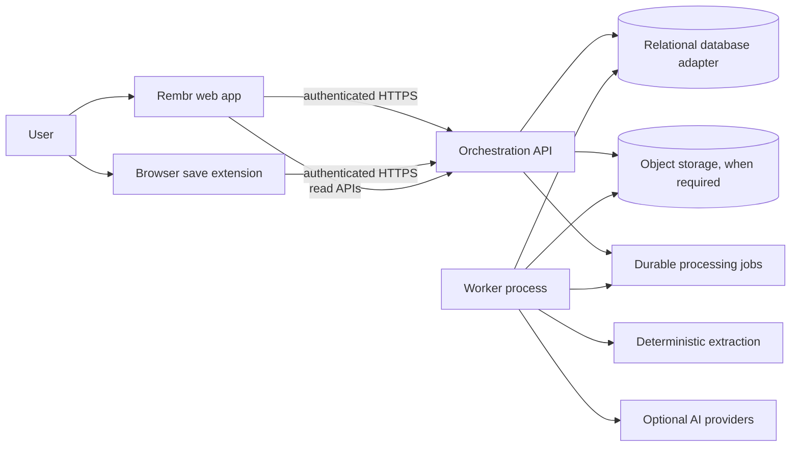

# Rembr system design and boundaries

## Status and evidence

This is a rebuild target derived from the IScraper reference checkout at `D:\IScraper-main\IScraper-main`. Current source is authoritative for what exists. Notion and Obsidian inform intent and prior decisions; deployment behavior remains unverified unless supported by current hosted evidence. Line references in the feature documents and source ledger take precedence over assumptions in this overview.

## Product boundary

Rembr is a private, searchable memory for saved web content, with a focused marketer workflow layered on that core. The shared foundation is capture, durable processing, enrichment, indexing, retrieval, organization, and deletion/export. Marketing-specific collection or research experiences must consume the same saved-content contract rather than fork storage or indexing. The rebuild is a fresh project named Rembr; no code, credentials, customer data, or private deployment state is copied from the reference checkout.

In scope: web application, orchestration API, background worker, relational schema and migrations, browser extension, tests, operational scripts, and documentation necessary to reproduce the current tracked behavior. The current reference checkout contains `apps/orchestration` and `apps/ui`; no separate Expo/mobile app was found in the reviewed repository inventory. Recheck the tracked-file ledger before implementation if the reference branch changes. The extension is a separate client with separate permission, authentication, distribution, and browser-compatibility requirements.

## System context

The diagram expresses logical boundaries, not verified production topology. Phase 1 uses a durable local SQLite adapter; a hosted PostgreSQL/Supabase adapter remains a pre-deployment decision. See `../backend/backend-architecture.md`, `../backend/backend-data-and-worker.md`, and `../extension-security/extension-architecture-and-rebuild.md` for traced contracts and source evidence.

## Responsibility boundaries

| Component | Owns | Must not own |
|---|---|---|
| Web UI | Route-level composition, user interaction, presentation state, client-side validation | authorization decisions, durable job state, provider secrets, duplicated indexing rules |
| API | Authentication context, authorization, request validation, resource lifecycle, stable HTTP contract, enqueueing | long-running media/model work in request handlers, trusting caller-supplied ownership |
| Worker | Lease-based claiming, deterministic extraction, optional enrichment, retry classification, idempotent persistence | direct unscoped access to another user's records, unbounded retries, UI-specific policy |
| Database | Tenant ownership, constraints, durable jobs, indexes, audit-relevant state | being treated as an implicit job queue without lease/retry fields |
| Browser extension | Explicit save action, current-page extraction handoff, authenticated API client, minimal page UI | broad host access without a documented need, page-origin trust, hidden capture behavior |
| Provider adapters | Provider-specific request/response mapping, timeout and error normalization | being required for the core deterministic save/search path |

## Core processing lifecycle

1. A user submits a URL or invokes save from the extension.
2. API authenticates the principal, normalizes and validates input, confirms ownership for any referenced resource, then creates/updates the saved item and durable processing job transactionally where possible.
3. The API returns a stable accepted/pending response and resource/job identifiers. The UI renders pending, processing, ready, partial, failed, and deleted states from server data rather than guessing completion.
4. A worker claims eligible jobs with a lease token and bounded lease duration. Concurrent workers must not process the same live lease.
5. Worker fetches/extracts only under documented network and content policies, persists deterministic metadata and content, then optionally performs OCR/ASR/vision/model enrichment. URL safety must cover each redirect hop and the actual connection destination: resolve and reject non-public addresses, prevent DNS rebinding between validation and connect (for example, pin the validated address), and enforce network egress controls. A string/hostname check alone is not sufficient.
6. Each phase writes idempotently. Retryable errors use finite exponential backoff with jitter; permanent validation/policy failures become terminal; exhausted jobs remain inspectable and retryable through an authorized path.
7. Search combines exact/filterable metadata with lexical and semantic retrieval only where the schema and evidence support it. Deterministic retrieval remains available when vector/model infrastructure is down.
8. User deletion and export apply to source content, derived artifacts, embeddings, and outstanding jobs according to explicit retention rules.

The exact current status vocabulary and transitions must follow `../backend/indexing-worker-contract.md`; the sequence above is the target contract to preserve and improve, not a claim that every current path already conforms.

## Data ownership and invariants

- Every user-owned row has an explicit principal/tenant key and server-side authorization policy.
- Every child resource derives ownership from a validated parent relationship or independently enforces the same ownership boundary.
- URLs are normalized before deduplication; deduplication scope (per-user vs global) must be explicit and privacy-reviewed.
- A job has a durable identity, bounded attempt count, `available_at`/retry schedule, lease owner/token and expiry, last error category, and terminal timestamps as applicable.
- A worker may write only when its lease token still matches. A stale worker must not overwrite the newer attempt's outcome.
- Content source, extracted text, generated summary, embeddings, and user annotations remain distinguishable, versioned artifacts.
- Deleting a saved item prevents further processing and removes or schedules removal of dependent content and vectors; in-flight workers re-check deletion/ownership before committing.
- Model output is untrusted derived data: store provenance/model/version and allow regeneration or removal without losing original source data.
- API response shapes and extension auth handoff are versioned contracts; migrations preserve old data unless a documented backfill and rollback path exists.

## External dependencies and failure modes

| Dependency | Core path when available | Failure behavior required in Rembr |
|---|---|---|
| Relational store (SQLite in Phase 1; PostgreSQL/Supabase adapter before deployment) | identities, records, jobs, search metadata | fail closed for protected reads/writes; owner predicates and foreign keys on every access; never claim save success without durable state |
| Object storage | large captures/media/artifacts where used | preserve metadata and surface partial processing; retry only classified transient errors |
| Fetch/extraction runtime | article/title/text extraction | validate URL and redirect chain; bounded time/bytes; classify unsupported and blocked targets |
| Optional local OCR/ASR/vision runtime | deterministic or local media extraction | feature-detect runtime; skip optional stages without losing core text/metadata |
| Model providers | enrichment/reasoning/semantic features | optional, timed, rate-limited, redacted; deterministic baseline and explicit degraded state |
| Browser extension APIs | page capture and toolbar/popup behavior | permission-minimal experience; API contract errors visible; no unsafe assumption that current tab/page is trusted |

## Proposed improvements (must remain labeled proposals)

1. Define one versioned saved-item and processing-job contract consumed by web and extension clients.
2. Make the core create/save and deterministic extraction path usable without an AI provider.
3. Separate content fetch safety from parsing: DNS/IP and redirect validation, response-size/time limits, content-type allowlist, and outbound network policy against SSRF.
4. Make deletion/export semantics include derived artifacts, embeddings, job cancellation, and provider-retention boundaries.
5. Adopt explicit partial-ready outcomes for optional stages and expose phase-level progress without leaking sensitive source content into logs.
6. Build a small permission-minimal extension release surface with automated manifest/origin checks and browser-level tests.
7. Add request/worker correlation IDs and redacted audit events for lifecycle transitions.
8. Keep search quality improvements measurable: lexical baseline, labeled evaluation set, semantic reranking as a separately measured stage.

## Non-goals and guardrails

- Do not change the reference repo or copy its repository history into Rembr.
- Do not import real user data, secrets, provider keys, production database contents, or private deployment configuration.
- Do not promise exact visual reuse; a distinct Rembr visual system will be specified after functional workflows.
- Do not treat historic Notion specs, old chats, passing unit tests, or local security scans as proof of current hosted behavior.
- Do not let AI enrichment become a prerequisite for capture, read, delete, or export.

## Design review checklist

- [ ] Each UI workflow traces to API contract, data owner, authorization rule, failure state, and test evidence.
- [ ] API validates all identifiers and derives actor identity from trusted auth context.
- [ ] Cross-tenant read/write tests cover every user-owned resource and child resource.
- [ ] Worker lease fencing and idempotency are tested with concurrent and stale workers.
- [ ] URL fetch path is protected against SSRF, redirect pivots, oversized payloads, and hostile content.
- [ ] Deletion/export include originals, derived data, vectors, jobs, and external-provider retention disclosures.
- [ ] AI stages have deterministic fallback and recorded provenance.
- [ ] Extension permission, auth storage, page-origin, CORS, token revocation, and CSP contracts are documented and tested.
- [ ] Database migrations have forward, rollback or repair, and deployed-schema verification steps.
- [ ] Accessibility, responsive states, keyboard behavior, and reduced motion are specified per screen.

## Related documents

- [Architecture decisions](architecture-decisions.md)
- [Phase roadmap](../rebuild-plan/phase-gated-roadmap.md)
- [Final review checklist](../quality/final-review-checklist.md)
