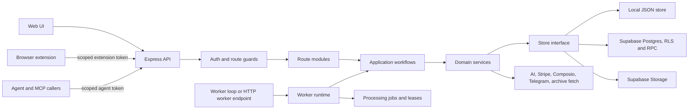

# IScraper Backend Architecture (Source Audit)

**Purpose:** describe the current backend implementation as the source-backed baseline for Rembr. This is an audit record, not a claim that hosted services or credentials were live-tested. The source checkout is `D:/IScraper-main/IScraper-main`; references use repository-relative paths and one-based line numbers.

## System shape

The backend is a Node/Express orchestration service in `apps/orchestration`. `src/server.js` composes HTTP middleware, route modules, application workflows, and a selected store. The storage adapter is either JSON/local (`src/stores/localStore.js`) or Supabase/Postgres (`src/stores/supabaseStore.js`). Long-running indexing, data export, and scheduled automation run through a worker runtime (`src/runtime/workerRuntime.js`) that shares the same application services and store abstraction.

## Composition and request ordering

`createApp` constructs memory uploaders, bounded/in-memory rate limiters, the `http` dependency bundle, then the workflow bundle before registering routes (`src/server.js:44-122`). It adds request observability and correlation IDs, error-body correlation fields, security headers, a general IP limiter, CORS, then raw Stripe callback routes before JSON parsing. Public health/feedback, admin, worker, Lens, token integration, and OAuth callback routes are mounted before the global authenticated-user middleware (`src/server.js:124-177`). All account, export, library, private integration, import, private search, workflow, and automation routes are mounted after that middleware. The error handler is last (`src/server.js:191`).

This ordering is a security invariant: route families mounted before global user auth must perform their own authentication/signature checks. The token integration routes authenticate extension/agent tokens inside route handlers. Admin and worker routes call their own assertions. Stripe receives the unparsed request body so signature verification can operate on the raw payload. Authenticated routes first resolve the Bearer token, check account deletion state, ensure the user row exists, attach `req.user`, and record timing (`src/server.js:162-189`, `196-263`).

Auth behavior: normal user auth delegates to `store.getUserFromToken`; stores requiring auth reject absent tokens, while local mode falls back to `x-user-id`/`local-dev-user` (`src/http/auth.js:5-22`). Extension tokens are hashed before lookup and checked for a required scope (`src/http/auth.js:24-37`); agent tokens use a separate header or Bearer value and scope (`src/http/auth.js:39-52`). Admin access supports a timing-safe API key, allowlisted email/password, or allowlisted Supabase user (`src/http/auth.js:54-91`). Worker access requires a configured key and timing-safe equality (`src/http/auth.js:93-109`). Profile completion and account-deletion gates are separate checks (`src/http/auth.js:111-140`).

## Main domain flows

### Import and capture

`createImportFromFiles` parses supported exports, rejects empty parses, records an import and request/correlation IDs, upserts normalized items with `queued` initial status and duplicate-skip policy, then creates durable jobs (`src/application/importWorkflow.js:5-45`). Response distinguishes parsed count, newly created count, skipped duplicates, collections, and queued jobs. Manual/link captures use the same import and saved-item boundary; optional page archiving is best-effort at the response lookup boundary, queued jobs are handed to the worker, and Smart Collections are refreshed (`src/application/importWorkflow.js:47-113`). Parser and storage helpers are in `services/exportParser.js`, `services/instagramParser.js`, `services/pinterestParser.js`, `services/xBookmarksParser.js`, `services/linkSaver.js`, and `services/storageImports.js`.

Uploads accept a bounded set of export extensions and MIME types (`src/http/uploads.js:9-24`). Express memory upload limits default to 25 MiB per file and at most 20 files (`src/server.js:48-74`); chunked storage uses a configured chunk size and a maximum of 100 chunks (`src/http/uploads.js:121-128`). Uploaded paths must be prefixed by the authenticated user's ID before the server downloads them from a private bucket (`src/http/uploads.js:59-62`, `138-190`). The import route revalidates the assembled file size/type before parsing. Note-image uploads use a separate image filter and bucket.

### Review and indexing

Review approval associates items with an import, moves unfinished items to `queued`, creates jobs grouped by import ID, and leaves already-complete items complete (`src/application/libraryWorkflow.js:36-84`). Manual enrichment skips items pending human review and avoids duplicate enqueueing unless forced (`src/application/libraryWorkflow.js:117-172`). The worker claim model uses `queued`, active (`downloading`, `analyzing`), paused, and terminal statuses; leases and retry timestamps govern eligibility (`src/services/queue.js:1-99`). Exponential backoff is capped, and expired active leases are treated as claimable when retries are due (`src/services/queue.js:32-72`).

`runWorkerPass` discovers eligible user/import scopes, processes them under configured concurrency/caps, then uses remaining capacity for data-export jobs (`src/runtime/workerRuntime.js:87-129`). `processIndexingScope` delegates the actual pipeline to `services/worker.js`, passing provider/model configuration, job lease/retry limits, storage, and optional local ML parameters (`src/runtime/workerRuntime.js:176-202`). The loop also attempts due automations and sleeps briefly after productive passes or uses the idle delay otherwise (`src/runtime/workerRuntime.js:132-174`). The standalone runner applies CLI overrides, production preflight, observability, shutdown handlers, store selection, and scheduled automation execution (`src/worker/indexing-runner.js:11-100`).

### Analysis and search

Indexing separates deterministic extraction from optional model work: `services/analyzer.js` derives rule-based metadata, can call configured text/media providers, and emits structured analysis. `services/embeddings.js` builds bounded text from an item and its analysis, supports OpenAI/OpenRouter/provider credentials, and produces the vector used by semantic retrieval. Optional `services/localMlExtractors.js` calls the local extractor API; `src/ml/localExtractorService.js` is a separate Express service that validates bounded image/media payloads and invokes configured external commands for OCR, transcript, and visual vectors. A local extractor may return partial results; it is not an included model package. Provider choices, credentials, and allowed-purpose checks are in `services/providers.js`, `providerClients.js`, and `credentials.js`.

Search combines keyword/metadata results with optional semantic candidates. `createSearchWorkflow` enforces AI usage limits, creates or reuses bounded search results, records search events/timings, and only invokes answer synthesis when requested/configured (`src/application/searchWorkflow.js:9-27`, `58-303`). Private search and library-chat routes are IP-limited and forward to that workflow; visual search uses a distinct image-analysis path (`src/routes/searchPrivateRoutes.js:18-177`). Lens converts an image to a query and returns a compact public item representation (`src/routes/searchRoutes.js:12-39`, `src/application/searchWorkflow.js:32-46`). Stored visual similarity and Lens are distinct capabilities: the former ranks persisted visual vectors (`services/visualSimilarity.js`, `services/similarVisuals.js`); the latter analyzes a supplied image (`application/screenshotWorkflow.js`).

### Library, archive, notes, and collections

The library workflow builds link-health/reminder summaries, checks a bounded set of links, queues enrichment, and refreshes smart collections (`src/application/libraryWorkflow.js:87-193`). `archiveWorkflow.js` retrieves readable page content, normalizes host/source metadata, and backfills missing metadata only from a successful archive (`src/application/archiveWorkflow.js:8-146`). User notes and image assets are handled by `services/notes.js` and `application/noteAssetWorkflow.js`; item archives and link checks use `services/pageArchive.js` and `services/libraryCare.js`. Graph creation/export and smart-collection membership are separate services (`services/graph.js`, `services/smartCollections.js`).

### Automation and publishing

Automation persistence is behind `repositories/automationRepository.js` and `automationChatRepository.js`; domain generation, validation, Gmail read execution, connection state, scheduling, and run history live in `services/automations.js` and `services/automationChats.js`. Models and provider APIs are configured from environment variables in `src/config.js`. Automation chat messages and definitions are user-owned; scheduled runs use database claim functions and the worker. Content workflow generation and publishing use `services/contentWorkflows.js`; publish actions have a separate approval step in the application flow, while Gmail automations are read-oriented. Provider behavior must not be represented as live-verified without authorized provider credentials.

### Billing, credits, data export, deletion

`application/billingWorkflow.js` only constructs a Stripe client when a secret exists. Checkout and webhook behavior are in integration routes and store logic; purchase/paid-usage correctness depends on SQL RPCs (`migrations/202605080002_credit_purchases_admin.sql`, `20260926173449_shared_request_rate_budgets.sql`). `services/credentials.js` implements AES-256-GCM encrypt/decrypt and secret masking, but a repository-wide source search found no production call site beyond the module itself; `CREDENTIAL_ENCRYPTION_KEY` is read by config but provider-credential persistence/use is not wired in the reviewed orchestration source. The `user_provider_credentials` table is referenced by deletion cleanup, and provider catalogs/clients exist, so this is a likely incomplete integration rather than a confirmed live feature. Data export is a persisted request/step pipeline handled asynchronously by `services/dataExportPipeline.js` and the worker; a ready artifact is served after owner lookup and download auditing (`routes/dataExportRoutes.js`). Account deletion is an explicit user request with export-confirmation, immediate access/job freeze, admin approval, ordered retryable steps and audit records; concurrency and partial-commit behavior remain risks (`services/accountDeletion.js`, `routes/accountRoutes.js`, `routes/adminRoutes.js`).

## Persistence boundaries

The application workflows accept a store object rather than directly coupling route logic to Supabase. Local JSON storage supports isolated development/demo use (`src/stores/localStore.js`); Supabase persistence uses the service-role client, explicit user-scoped queries, database RLS, private storage buckets, and selected server-only RPC functions (`src/stores/supabaseStore.js`). The store contract is large and capabilities are sometimes guarded with `typeof store.someMethod === 'function'`, allowing local and hosted stores to differ. Rembr should document and explicitly type this interface instead of assuming every adapter implements every optional capability.

Principal entities from migrations: users/profiles; imports and saved items; collections and item assets; item analysis, text/visual embeddings, and processing jobs; provider credentials and credit accounts/transactions/purchases; extension tokens and Lens events; admin state and activity; export requests and steps; audit events and tenant classifications; search events/feedback; notes/assets; smart collections/items; item archives/link checks/reminders; capture connections; automations/runs/chats/messages; and shared request-rate budgets. See `backend-data-and-worker.md` for migration-by-migration details and RLS boundaries.

## Operational configuration and observable limits

`src/config.js` reads storage, auth, provider, concurrency, worker, upload, rate-limit, analytics, and app URL settings. Defaults are code defaults, not proof of deployed values (`src/config.js:7-127`). Worker preflight requires Supabase storage and service-role credentials in production/Supabase mode; missing OpenAI only produces a basic-indexing warning (`src/worker/preflight.js:1-45`). Local limiter state is in-memory and therefore process-local (`src/http/rateLimit.js:9-41`); shared per-user AI/provider quotas are separately persisted via `services/rateBudgets.js` and its SQL migration. Observability adds request IDs, timing, support/security events, and optional PostHog capture (`services/observability.js`, `services/auditLog.js`).

## Audit status and limits

- Source/config behavior described here is read from the checkout. The current worktree has unrelated pre-existing edits; no source files were modified for this document.
- Vercel/Render environment settings, Supabase live schema/RLS, production credentials, and provider connections are not verified by source inspection.
- The service is Node CommonJS, Express, JavaScript, Supabase client/Postgres, with a local JSON adapter. No OpenAPI contract is present in the reviewed source inventory; the route table is source-derived.
- Proposed Rembr changes belong in the separate Rembr implementation and should be logged as proposals until accepted; this document records current behavior first.

## Related documents

- [API contracts](api-routes-and-contracts.md)
- [Worker contract](indexing-worker-contract.md)
- [Migration and RPC contracts](critical-migration-contracts.md)
- [Feature acceptance matrix](../rebuild-plan/feature-and-acceptance-matrix.md)
