# Indexing worker contract

**Evidence basis:** source review of `apps/orchestration/src/services/worker.js`, `runtime/workerRuntime.js`, `application/workerWorkflow.js`, `worker/indexing-runner.js`, `worker/preflight.js`, `services/queue.js`, relevant worker tests, and the corresponding store methods. Paths are relative to `D:/IScraper-main/IScraper-main`. This describes repository behavior; production scheduling, credentials, provider access, and deployed database state were not exercised.

## Responsibility and entry points

The worker is a background pipeline over already persisted saved items. Import requests create items and queued jobs; workers claim jobs, fetch optional media, create analysis and embeddings, persist results, and update item/job statuses. API-triggered inline processing is optional. The same service can be invoked by a long-running worker process or an authenticated HTTP worker route.

| Entry | Behavior | Evidence |
|---|---|---|
| `createWorkerWorkflow().queueIndexingWork` | If `forceInline` or `inlineIndexingEnabled`, starts processing asynchronously and returns `mode: inline`; otherwise returns `mode: vm-worker` metadata for an external worker to pick up. | `src/application/workerWorkflow.js:73-84` |
| `startProcessing` | Fire-and-forget processing; catches top-level failure, records a support event, and reports observability error. | `src/application/workerWorkflow.js:38-57` |
| HTTP `workerProcessHandler` | Requires worker auth, discovers processable scopes, caps requested work to at most 5 jobs for a route invocation, then executes a worker pass. | `src/application/workerWorkflow.js:91-119` |
| `worker/indexing-runner.js` | CLI bootstrap, store selection, preflight checks, signal handling and runtime launch. | `src/worker/indexing-runner.js` (reviewed; exact operational behavior depends on environment) |
| `worker/run-once.js` | One-shot worker entrypoint. | `src/worker/run-once.js` (review pending) |

`runtime/workerRuntime.js:5-21` clamps configured batch, scan, global/per-user concurrency, attempt count, lease duration, retry delay, idle delay and run-once mode. `runWorkerPass` scans job scopes and processes them, then spends any remaining pass capacity on data-export requests (`:87-120`). In a loop, scheduled automations are attempted after each indexing/export pass (`:123-151`). A route request with `totalJobCap` forces scope concurrency to one (`:42-46`); this is distinct from the background loop’s configured global concurrency.

## Job state machine

```mermaid
stateDiagram-v2
  [*] --> queued
  queued --> downloading: claimed / processing begins
  downloading --> analyzing: media preparation finished or skipped
  analyzing --> done: analysis saved; usage recorded if paid/free source
  downloading --> paused_needs_billing: classified pause error
  analyzing --> paused_needs_billing: classified pause error
  downloading --> paused_api_limit: provider limit
  analyzing --> paused_api_limit: provider limit
  downloading --> paused_missing_provider: classified pause error
  analyzing --> paused_missing_provider: classified pause error
  downloading --> queued: transient error, attempts remain
  analyzing --> queued: transient error, attempts remain
  downloading --> failed: transient error, attempts exhausted
  analyzing --> failed: transient error, attempts exhausted
  queued --> downloading: retry after nextAttemptAt / lease claim
```

The exact permitted statuses and queue selection/backoff policy are implemented in `services/queue.js`; claimed jobs use leases and attempts. Store support is capability-detected: if `claimNextJobs` exists, batches are claimed transactionally; otherwise processing selects from `getJobs` and updates status directly (`services/worker.js:84-101`). In the fallback path there is no lease-based concurrency guarantee. Store lease methods must therefore be part of the production Supabase contract, while the local adapter serves development/testing.

### Processing phases

1. Ensure the media output directory exists; choose batch size bounded to 1–5 within `processImportJobs` (`services/worker.js:58-116`).
2. Claim a batch, optionally scoped by user/import and constrained by lease owner, lease duration, per-user concurrency and attempts.
3. Load the saved item. If missing, fail the job, clear lease fields and emit a `background_job_failed` support event (`:134-156`).
4. Transition the job/item to `downloading`; choose an analysis plan; optionally download media for posts/reels when the caller enabled download (`:158-200`). Download errors are swallowed and produce an empty media list (`:202-210`), so basic text processing may continue.
5. Derive a source-content hash and reuse compatible media analysis only when prior metadata has the same hash and processing level `ml` or `ai_enriched` (`:211-225`, `:427-437`).
6. Transition to `analyzing`; try optional local media analysis, then paid media analysis only if local analysis is absent; create text analysis when a text credential exists. Each provider step is bounded to 90 seconds (`:228-262`, `:25`).
7. Attach processing/hash metadata, verify lease ownership, and optionally create a text embedding if its content/model changed. Embedding failure is logged but does not fail indexing (`:264-310`).
8. Persist analysis, optional text/visual embeddings, then usage accounting for a plan whose source is `free` or `paid`; mark job `done` and clear the lease (`:311-340`).
9. On classified pause, update item/job to a paused state and emit a blocked support event. On provider quota, pause as `paused_api_limit`. Other errors become queued retry or terminal failed based on attempt count; retry time is computed by `nextRetryAt` (`:341-405`).

The lease is re-checked before saving and again before final error handling (`:263`, `:309`, `:342`). This prevents a worker that lost its lease from writing later results, assuming the store’s lease-token read/update methods are atomic enough for the chosen database contract. Analysis and embedding persistence are separate calls; the code does not wrap the full success path in one database transaction, so partial persistence is possible if a later store call fails.

## Provider and credit selection

`chooseAnalysisPlan` builds app-owned OpenAI credentials only from `config.openAiApiKey` and configured models (`services/worker.js:473-533`). If no app key exists, the plan is basic with no provider credentials. If the store lacks `getCredits`, an app key enables AI without a usage source classification. If credits are supported, a positive `paidCredits` balance enables app-owned text/media/embedding calls and marks the source `paid`; zero balance selects basic processing.

Although provider credential storage and the provider registry support user-configured provider credentials elsewhere in the backend, this worker selection function does not call `store.getPreferredProviderCredential` or pass `credentialEncryptionKey` into a resolver. `worker.test.js` explicitly asserts that user-saved provider credentials are ignored and the worker selects basic processing (`test/worker.test.js:6-31`). This is verified current behavior, not an inference. Product owners must decide whether Rembr preserves this app-key/credit-only policy or implements the separate user-provider path; document the decision before implementation.

An implementation inconsistency to resolve: the success path records usage for `source === 'free' || source === 'paid'` (`services/worker.js:323-330`), but the current plan-selection branches shown above return `null` or `paid`, not `free`. `test/worker.test.js` verifies the paid and no-provider cases. Do not assume a free-credit path exists without locating another plan producer; the current worker function has no such branch.

## Retry, failure, and visibility behavior

- Job/item state update is best-effort only when the store exposes optional methods; the production adapter should expose the complete interface.
- Classified missing-provider/billing/provider-limit errors pause rather than consume normal retries, and emit `background_job_blocked` events (`services/worker.js:349-374`).
- Other failures use a user-safe error mapper, exponential retry scheduling and `maxAttempts`; the terminal path marks the item failed (`:375-405`, `:599-616`).
- `withTimeout` races the provider promise but cannot cancel the underlying provider request when the timer wins (`:560-566`). This can leave provider work running after the job transitions to retry/pause; consider abort-capable provider clients in Rembr.
- Download errors are not exposed as an explicit job failure, while indexing continues without media. This makes a completed job insufficient evidence that source media was downloaded or visually analyzed.
- Worker pass observability reports processed scopes, counts and failed scope count; errors inside individual scopes are caught and do not abort other scopes (`runtime/workerRuntime.js:42-84`). Data-export failures are caught separately (`:194-205`).

## Persistence interface dependencies

| Store operation | Purpose |
|---|---|
| `getProcessableJobScopes`, `claimNextJobs` / `claimJob`, `getJob`, `updateClaimedJob` | Discover and safely lease work |
| `getItem`, `setItemStatus`, `markItemFailed` | Load source and expose progress/error state |
| `getAnalysisMetadata`, `saveAnalysis` | Reuse and persist analysis metadata/results |
| `getEmbeddingMetadata`, `saveEmbedding`, `saveVisualEmbedding` | Avoid duplicate embedding work and persist search vectors |
| `getCredits`, `recordUsage` | Gate app-owned paid processing and record usage |
| `recordSupportEvent` (service wrapper) | Operational/security audit trail |

The actual Supabase implementation and SQL lease functions must be checked together: interface parity alone does not prove locking, RLS, uniqueness, retry eligibility, or transaction semantics. Existing local-store tests prove deterministic local behavior only.

## Rebuild plan for Rembr

1. Freeze a state/status enum and transition table shared by API, worker, persistence and UI.
2. Define a typed worker/store contract, including atomic claim/lease, fencing token, heartbeat/lease renewal, idempotency key, attempts, next-run timestamp and cancellation semantics.
3. Separate plan selection from job execution. The plan should explicitly state provider, model, billing source, whether media/text/embeddings are enabled, and user-visible consent/budget limits.
4. Make source download, local extraction, hosted media analysis, text enrichment and embedding independent stages with stage-level errors and durable output hashes.
5. Persist each stage idempotently, and use a transaction/outbox or equivalent for final status/usage accounting. Define how partial persistence resumes.
6. Add cancellation/timeouts that abort outbound requests where supported; bound downloaded bytes, MIME types, duration and archive/URL fetch destinations.
7. Expose a user-safe progress projection and a separate operator diagnostic view without provider secrets or raw sensitive payloads.
8. Test competing workers, lease expiry/reclaim, duplicate delivery, provider timeout/429, partial writes, missing item, billing pause, export/automation fairness, and local-vs-Supabase parity.

## Tests read and coverage limits

- `test/worker.test.js`: plan behavior for absent app provider, configured app OpenAI with paid credits, and no paid balance.
- `test/worker-billing.test.js`: local-store end-to-end basic indexing, app-key billing, media/embedding behavior, and failure cases across many scenarios; only the first section was reviewed deeply in this pass, so do not treat the whole file as line-by-line audited here.
- `test/workerRuntime.test.js`, `test/queue.test.js`, `test/workerRoutes.test.js`, `test/workerPreflight.test.js`: inventoried for runtime/queue/route/preflight areas; assertions still require complete pass.
- `test/supabaseStore.test.js`: selected lease/usage/store coverage exists, but this doc does not claim exhaustive test review.

The source exposes behavior; tests do not establish hosted provider credentials, production schedules, Supabase RLS correctness, or runtime load characteristics. Those remain verification items.

## Related documents

- [Backend architecture](backend-architecture.md)
- [API contracts](api-routes-and-contracts.md)
- [Migration and RPC contracts](critical-migration-contracts.md)
- [Feature acceptance matrix](../rebuild-plan/feature-and-acceptance-matrix.md)
