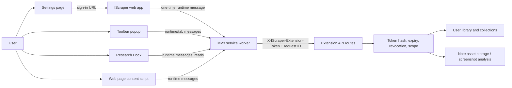

# Browser Extension: Architecture, Behavior, and Rembr Rebuild Specification

## Audit basis and confidence

This document traces the tracked Chromium extension source and the IScraper API contract it calls. Source behavior is confirmed from the checked-out repository at `D:\IScraper-main\IScraper-main`; the parent checkout was not modified. The package is Manifest V3, version 0.4.0, with Chrome 116 as its declared minimum (`extensions/save-to-iscraper/manifest.json:1-62`). The README says the store release is still “coming soon”; store availability and production behavior have not been independently verified (`extensions/save-to-iscraper/README.md:1-8`).

This is a source audit, not a live browser or hosted API test. Claims in the extension README, privacy policy, permissions rationale, and store draft describe intended behavior and are called out as documentation claims unless source flow corroborates them.

## Product surfaces

| Surface | User purpose | Source |
|---|---|---|
| Toolbar popup | Connect account; capture the active page; start screenshot or text/media capture; open Research Dock; edit capture details | `popup/popup.html`, `popup/popup.js`, `popup/popup.css` |
| Settings page | Configure app URL, default action/collection, screenshot options and privacy metadata; connect/disconnect/reset; view request diagnostics | `options/options.html`, `options/options.js`, `options/options.css` |
| Research Dock | Search/review recent library items, save manually entered or dragged links, open item/source | `sidepanel/sidepanel.html`, `sidepanel/sidepanel.js`, `sidepanel/sidepanel.css` |
| Page overlay | Draw screenshot crop; select text or hover media and click a save affordance; show save/undo/status feedback | `content/content.js`, `content/content.css` |
| Background service worker | Validate one-time connection, mediate page/UI messages, call API, capture visible tabs, update badge and record latest request metadata | `background/service-worker.js` |

### Popup flow and state

On open, `popup.js` reads the active tab, synced preferences, local extension session, and safe page metadata (`getActiveTab`, `getSettings`, `getExtensionSession`, `readPageMeta`; `popup/popup.js:36-103`). A connected session hides the sign-in panel and exposes four actions. `defaultAction` may immediately start URL capture or screenshot capture after a short delay (`popup/popup.js:318-340`).

- **Capture URL:** accepts only `http(s)` active tabs, assembles URL/title/description/OpenGraph image/author/platform/collection/note and a client action ID, then sends `ISCRAPER_SAVE_URL` to the worker (`popup/popup.js:104-162`). A new item gets a five-second Undo; an existing duplicate displays “Already in your library.” (`popup/popup.js:164-209`).
- **Screen Capture:** asks the content script to start a crop overlay, passing the scoped token and capture options. If no content listener exists, it injects the bundled CSS/script into the active tab and retries (`popup/popup.js:211-253`).
- **Select Text or Media:** starts a two-minute selection mode with page metadata, default collection and note. It uses the same inject-and-retry flow (`popup/popup.js:255-296`).
- **Research Dock:** opens the browser side panel for the active window; failure leaves an explanatory status (`popup/popup.js:298-309`).
- **Connect:** opens `${appUrl}/app?connectExtension=1&extensionId=...` (`popup/popup.js:311-316`).

The popup's “include source URL/title” settings are passed to screenshot and selection modes, not to ordinary URL capture; their labels in settings specifically mention screenshots. The active URL is always included in URL capture.

### Page overlay flow

The content script runs once per page context (`window.__iscraperCaptureLoaded` guard; `content/content.js:1-34`). For screenshot capture it shades the viewport, tracks a pointer drag, rejects crops smaller than 20×20 CSS pixels, requests a visible-tab PNG from the worker, then crops it on a canvas. Balanced output caps width at 1200 pixels; high quality caps it at 2000 (`content/content.js:39-71`, `content/content.js:329-366`). The resulting image is sent to the screenshot endpoint with collection, optional source metadata and the auto-analysis preference. On success it shows Undo for five seconds; on failure it shows a short-lived error toast (`content/content.js:173-201`, `content/content.js:400-450`).

Selection mode attaches capturing `mouseup`, `keyup`, `mouseover`, and `scroll` listeners. Selected text is normalized and truncated to 1,800 characters; images/videos smaller than 40×40 pixels are ignored. The page itself is not sent until the user clicks the injected save button (`content/content.js:99-160`, `content/content.js:230-318`). Passive mode is enabled only when the user setting is on, a session exists, and the current page is HTTP(S). Passive mode provides the same click-to-save button for text/media.

On initialization and preference/session changes, the content script may call `checkSavedPageStatus`. A positive response adds a “Saved in IScraper” pill for 3.2 seconds (`content/content.js:71-98`, `:491-506`). When passive mode is disabled and the current mode is not `passive` (including initial page setup), the `else` branch still requests status. When toggling off from an active passive mode, the `else if` branch stops the mode without requesting status in that refresh. See EXT-01: disabling the icon does not reliably disable status checks on page initialization or later non-passive refreshes.

### Settings and storage

Synced storage contains app URL and user preferences: default action, screenshot quality, auto-close, default collection, screenshot AI analysis, page title/source URL inclusion, and always-on capture icon. Local extension storage contains the scoped extension secret, token ID, connected email, and last request status. The source intentionally removes legacy `lensToken` fields when connecting or disconnecting. See `options/options.js:1-18`, `options/options.js:31-91`, and `background/service-worker.js:1-54`.

Settings display account email/state, extension version, and the last request action/time/ID/result. Request diagnostics exclude captured text, page URLs, image data, and the token (`options/options.js:120-132`; worker `recordLastRequest` at `background/service-worker.js:294-301`). The default app URL is `https://iscraper.vercel.app`.

### Research Dock

When connected, the panel requests eight recent items. Search submits a trimmed query; an empty query restores recent items. Result cards use `textContent`, show title/description/platform/collection/status and offer “Open Item” and “Source” (`sidepanel/sidepanel.js:62-134`). The user can enter a URL, optional note, or drop a link; the side panel sends the URL through the same worker save message, then refreshes recent items (`sidepanel/sidepanel.js:135-169`, `sidepanel/sidepanel.js:207-212`). Item/source opening is limited to HTTP(S) URLs in the extension UI and the worker (`sidepanel/sidepanel.js:176-179`, worker lines 107-123).

## Cross-component architecture

### Connection/token lifecycle

1. The user opens IScraper from the extension. The web application creates a 32-byte random `isx_` token and stores only its SHA-256 hash, scopes, name, and one-year expiry in `extension_tokens`. The plaintext token is returned once to the authenticated app (`integrationPrivateRoutes.js:31-49`; `services/extensionTokens.js:3-25`; migration `202605080006_lens_extension_tokens.sql:1-29`).
2. The app sends `ISCRAPER_EXTENSION_CONNECTED` to the extension ID. The worker only accepts the allowlisted origin `https://iscraper.vercel.app`, requires an `isx_` prefix and app URL matching that origin, then puts app URL in `storage.sync` and token, token ID, and email in `storage.local` (`AppShared.jsx:1220-1276`; `service-worker.js:29-54`).
3. Capture/API calls carry `X-IScraper-Extension-Token`, `X-Request-ID`, and an action label. The server hashes the supplied secret, checks record existence, expiry, revocation, and required scope, and updates last-used time (`http/auth.js:22-35`; `supabaseStore.js:931-947`; `localStore.js:1378-1388`).
4. Settings “Disconnect” currently clears local session values but does not call the authenticated token-revoke endpoint. Revoking the server token is a separate account-side action (`options/options.js:80-85`; `integrationPrivateRoutes.js:51-62`).

### Extension API contract

All these routes also pass the general API rate limiter; link save uses import-specific limiting and library search uses search limiting (`server.js:60-72`, `server.js:128-136`). Extension-specific calls require the appropriate scope and a completed account profile; pending deletion blocks extension access (`integrationRoutes.js:63-80`).

| Method and route | Scope | Request / behavior | Response and side effects |
|---|---|---|---|
| `POST /api/extension/saves/link` | `saves:create` | Manual-link payload with URL, metadata, collection/note; validates and normalizes via shared import workflow | 201 with import, item, duplicate/job counts and request/correlation IDs; queues indexing with `shouldDownload: false`; refreshes smart collections (`integrationRoutes.js:125-167`) |
| `DELETE /api/extension/saves/:id` | `saves:delete` | Item ID | Deletes only the caller-owned item when its import source is `browser-extension`; returns deleted/item ID; refreshes smart collections (`integrationRoutes.js:170-188`) |
| `POST /api/extension/captures/screenshot` | `captures:create` | Multipart image plus title/source URL/source title/collection/autoAnalyze | 201 `{item}`; validates image through note-upload middleware, creates note item and persists asset, optionally analyzes; analysis failure is logged while capture is retained (`integrationRoutes.js:191-266`) |
| `POST /api/extension/captures/selection` | `captures:create` | JSON kind `text|image|video`, selected text or media URL, alt text, source page, note, collection | 201 `{item}`; creates a note-backed item with `iscraper-extension-selection`; validates required content (`integrationRoutes.js:269-321`) |
| `DELETE /api/extension/captures/:id` | `captures:delete` | Item ID | Deletes only caller-owned extension screenshot/selection records; deletes associated asset objects; refreshes smart collections (`integrationRoutes.js:324-340`) |
| `GET /api/extension/library/recent?limit=N` | `lens:search` | Limit clamped to 1–20, default 8 | Reduced item projection; private account fields are not returned (`integrationRoutes.js:343-350`) |
| `GET /api/extension/library/search?q=...&limit=N` | `lens:search` | Cleaned query; blank query returns no results; search limiter applies | Search result projection, up to 20 results (`integrationRoutes.js:352-364`) |
| `GET /api/extension/library/status?url=...` | `lens:search` | Normalized URL comparison | `{saved, item}` for the caller’s matching item or `{saved:false,item:null}` (`integrationRoutes.js:366-374`) |
| `GET/POST/DELETE /api/extension-tokens[/:id]` | Authenticated web session | List/create/revoke scoped token | Creation returns plaintext once; list returns public metadata only; revocation is user-scoped and audited (`integrationPrivateRoutes.js:26-62`) |

## Rembr rebuild sequence

1. Recreate manifest and packaging contract: supported Chromium versions, popup, side panel, settings, background worker, content script, permission rationale, privacy notice, and validation/build commands. Resolve canonical versus configurable app-origin behavior before coding.
2. Implement authenticated connection and token state first: token generation/hash/revocation/expiry/scopes, one-time app-to-extension message, local-only secret storage, reconnect, reset, and account-side revocation. Write tests for invalid origin, malformed token, expired/revoked token, and missing scope.
3. Implement the URL capture vertical slice: metadata extraction, input normalization, duplicate behavior, import/job creation, collection assignment, status/diagnostics, and safe Undo. Verify SSRF/private URL rejection in the shared backend path.
4. Implement text and media reference capture with explicit click-to-save, text/URL truncation, source attribution preferences, accessible confirmation, and scoped delete.
5. Implement screenshot crop and upload: permissions/injection fallback, pointer crop, pixel scaling and size cap, upload validation, optional analysis, partial provider failure behavior, asset cleanup, and Undo.
6. Implement the dock: recent list, search, empty/error/loading states, dragged/manual URL save, item/source navigation, and privacy-safe result rendering.
7. Implement passive save affordance and saved-page status as independently controllable preferences. Make status checks opt-in or clearly expose a dedicated status-check preference; do not couple hidden network activity to a display toggle.
8. Add user-level diagnostics, store policy/permissions copy, icon assets, keyboard/screen-reader flows, responsive popup/panel QA, and verified package instructions.
9. Validate browser behavior manually in clean test profiles and add focused tests for extension message handlers, token persistence/revocation, preferences, crop math, status checks, error recovery, and API ownership isolation.

## Acceptance criteria for the Rembr extension

- Every capture is initiated by a user action; the selection helper never transmits selected text/media until the save control is clicked.
- A secret is shown only at token creation, stored locally by the extension, hashed server-side, scoped, expirable, revocable, and never written to request diagnostics.
- Only owned extension-created items can be undone; screenshot assets are removed along with their item.
- The configured app origin, manifest permissions, and externally connectable allowlist agree; unsupported origins are rejected in settings and at message boundaries.
- The URL-status network behavior and source metadata toggles match the user-facing privacy explanation and have direct regression tests.
- Popup, settings, side panel, crop overlay, selection controls, errors, and undo work with keyboard and assistive technology; page CSS cannot silently break or spoof the injected UI.
- Store listing and privacy claims match executable behavior and are not presented as approved/published until verified.

## Line-level function and message-path inventory

Line anchors below point to the authoritative tracked source under `D:\IScraper-main\IScraper-main`. Function line numbers identify each entry point; adjacent helper rows document the data transformation and handoff. This inventory complements the product-flow narrative above and was added after re-reading the current logic-bearing files. It is not a runtime proof.

### Background service worker

| Entry point | Logic and next hop |
|---|---|
| Install defaults — `extensions/save-to-iscraper/background/service-worker.js:1-27` | Seeds missing synced settings only; preserves existing values. |
| External app connect — `:29-55` | Accepts only `ISCRAPER_EXTENSION_CONNECTED`; checks sender origin, token prefix, and URL agreement; stores app URL in sync storage and secret/token metadata in local storage; removes legacy Lens token fields; replies asynchronously. |
| Runtime message router — `:57-124` | Routes URL/screenshot/selection create, saved-page lookup, URL/capture delete, visible-tab screenshot, and safe HTTP(S) tab open. Asynchronous branches return `true` and translate rejections into `{ok:false}` replies. No explicit sender allowlist is applied to these internal runtime message types. |
| `saveUrl` — `:126-137`; `saveScreenshot` — `:139-158`; `saveSelection` — `:160-180` | Each reads stored session and app URL, chooses request ID, issues scoped API request, decodes response, records non-content diagnostics, and returns item/result. Screenshot converts the data URL to a Blob/FormData; selection/link send JSON. |
| `deleteUrlCapture` — `:182-194`; `deleteCapture` — `:196-208` | Calls the corresponding item delete route using the stored secret and action metadata, records the result, returns deleted item identity. |
| `checkSavedPage` — `:210-231`; `setSavedBadge` — `:233-239` | Validates supplied page URL against sender tab URL before status lookup; updates toolbar badge for the sender tab from the API result. |
| `extensionHeaders` — `:241-249` | Constructs `X-IScraper-Extension-Token`, request ID, action, and optional content type headers. |
| `storedAppUrl` — `:251-255`; `storedExtensionSession` — `:257-270` | Loads sync origin and local token metadata; session accepts only an `isx_`-prefixed secret and otherwise returns disconnected state. |
| `responseBody` — `:272-292` | Parses JSON and converts unsuccessful HTTP responses into errors with request IDs where available. |
| `recordLastRequest` — `:294-301` | Writes timestamp/action/result/request ID to local storage, excluding page content and token. |
| `dataUrlToBlob` — `:303-312`; `appBase` — `:314-318`; `extensionToken` — `:320-324`; `safeHttpUrl` — `:326-333`; `safeOrigin` — `:335-341`; `createRequestId` — `:343-346` | Converts screenshots, requires HTTPS API base, checks token prefix, restricts navigation URLs to HTTP(S), parses origin, and creates client request IDs. `appBase` does not itself compare against the manifest's canonical origin; browser host-permission behavior was not runtime-tested. |

### Injected content script

The script is an IIFE guarded by `window.__iscraperCaptureLoaded` (`extensions/save-to-iscraper/content/content.js:1-37`); initialization installs a runtime listener for `ISCRAPER_START_SELECTION_CAPTURE` and `ISCRAPER_START_SCREEN_CAPTURE` (`:25-35`), then calls `initPersistentCapture()` (`:37`). The content script does not handle a runtime “stop” message; its manual selection mode stops through its own close/timer paths.

| Function / handler | Logic and next hop |
|---|---|
| `startCapture` — `:39-51`; `startSelectionCapture` — `:53-69` | Retain transient capture session metadata and create crop overlay or selection panel. |
| `initPersistentCapture` — `:71-85`; `refreshPersistentCaptureState` — `:87-99`; `startPersistentCapture` — `:101-108` | On initialization/settings/session updates, turns passive click affordance on/off. If passive mode is enabled it checks status; if disabled, it checks status except when the current `quickMode` is `passive`, where it stops the mode and skips that refresh's check. Initial page setup has no passive mode yet and therefore still checks status with a stored session (EXT-01). |
| `attachQuickListeners` — `:110-117`; `ensureRoot` — `:119-125`; `ensureQuickRoot` — `:127-133` | Hooks selection, media hover, and scroll events and creates roots in the page DOM. |
| `createCropOverlay` — `:135-174`; `saveSelectedArea` — `:176-200` | Tracks pointer rectangle, ignores tiny selections, obtains screenshot through `ISCRAPER_CAPTURE_VISIBLE_TAB`, crops on canvas, then sends `ISCRAPER_SAVE_SCREENSHOT`; on success presents Undo. |
| `showQuickPanel` — `:202-214`; `handleSelectionMouseup` — `:216-233`; `handleMediaHover` — `:235-252`; `showQuickButton` — `:254-267`; `removeQuickButton` — `:269-271` | Displays user-started text/media selector and passive click-to-save affordance. Selection/media data is kept in content context until explicit save click. |
| `saveQuickTarget` — `:273-309` | Builds text or media payload with truncation and page metadata preferences; sends `ISCRAPER_SAVE_SELECTION`; displays result and Undo. |
| Crop geometry — `updateBox` `:311-319`; `normalizeRect` `:321-327`; `captureCrop` `:329-354`; `loadImage` `:356-363` | Normalizes pointer bounds, scales viewport coordinates against captured image dimensions, draws crop, then encodes the result. |
| `showPanel` — `:365-398`; `showUndoToast` — `:400-447`; `showStatusToast` — `:449-461` | Renders result/Undo surfaces. Undo dispatches `ISCRAPER_DELETE_CAPTURE` and handles `{ok:false}`, but the awaited message promise has no local `try/catch` (EXT-04). |
| `closeCapture` — `:463-468`; `stopSelectionCapture` — `:470-489` | Tears down crop/selection state and optionally restores passive capture. |
| `checkSavedPageStatus` — `:491-498`; `showSavedPill` — `:500-510` | Sends current URL via `ISCRAPER_CHECK_SAVED_PAGE`; displays a timed saved badge if found. |
| `buildStoredQuickSession` — `:512-527`; `getStoredSettings` — `:529-544`; `getStoredSession` — `:546-557` | Reads local session and synced defaults and constructs capture metadata; secret is passed in extension runtime messages rather than exposed to page DOM. |
| `createRequestId` — `:559-562`; `sendRuntimeMessage` — `:564-574`; `waitForOverlayRemoval` — `:576-585` | Makes client ID, wraps Chrome callback messaging as a Promise, and waits for overlay teardown. |

### Popup, options, and Research Dock

| File and entry points | Logic and message/API path |
|---|---|
| `popup/popup.js:36-102` | `getActiveTab`, `getAppUrl`, `getExtensionSession`, `getSettings`, `detectPlatform`, and `readPageMeta` gather active-tab metadata/preferences/session. `readPageMeta` injects a small page-context metadata reader only on supported HTTP(S) pages. |
| `popup/popup.js:104-127` | `captureBody` and `captureDetails` normalize collection/note and combine page metadata with action details. |
| `popup/popup.js:129-209` | `captureUrl` sends `ISCRAPER_SAVE_URL`, displays duplicate/success state; `showUrlUndo`, `clearUrlUndo`, `undoUrlCapture` track an in-memory Undo window and route delete through worker. |
| `popup/popup.js:211-253` | `startScreenCapture` starts capture in content context, injects packaged CSS/script if listener is absent, then retries. |
| `popup/popup.js:255-296` | `startSelectionCapture` does the equivalent for text/media selection. |
| `popup/popup.js:298-316` | `openResearchDock` opens the side panel for active window; `openConnect` opens the app connect URL with runtime extension ID. |
| `popup/popup.js:318-340` | `init` loads UI state, connection, page title/platform and preference; optionally triggers configured default action. |
| `popup/popup.js:342-374` | `setBusy`, `createRequestId`, `sendRuntimeMessage`, `sendTabMessage` provide interaction state and Promise wrappers. Click listeners and options navigation are registered at `:376-383`. |
| `options/options.js:31-50` | `getAppUrl` and `getExtensionSession` load configured origin/token status. |
| `options/options.js:52-78` | `getSettings` reads preferences; `saveSettings` validates choices and HTTPS scheme, normalizes collection, and persists settings. It does not restrict the URL to the manifest origin. |
| `options/options.js:80-93` | `disconnect` removes local secret/metadata and local request state only; `resetSettings` restores preference defaults without revoking the server token. |
| `options/options.js:95-118` | `openConnect`, `renderConnection`, and `renderSettings` build connect link and settings state. |
| `options/options.js:120-151` | `renderTroubleshooting`, `validChoice`, `init` display safe request diagnostics and attach Save/Connect/Disconnect/Reset actions. |
| `sidepanel/sidepanel.js:23-60` | `getAppUrl`, `getSettings`, `getExtensionSession`, `apiGet` establish session and GET requests for Dock endpoints. |
| `sidepanel/sidepanel.js:62-83` | `loadRecent` and `runSearch` fetch recent/search data and update status/results. |
| `sidepanel/sidepanel.js:85-133` | `renderResults` and `resultCard` build result cards with `textContent`; separate buttons open item in app or source URL through safe worker tab-open message. |
| `sidepanel/sidepanel.js:135-169` | `saveLink` validates HTTP(S) URL and sends URL capture through worker, then refreshes recent items. |
| `sidepanel/sidepanel.js:171-189` | `openConnect`, `openUrl`, `setStatus`, `compact` handle connection, safe navigation, UI state, and text truncation. |
| `sidepanel/sidepanel.js:190-212` | `createRequestId`, runtime messaging wrapper, and `linkFromDrop` parse dragged links. |
| `sidepanel/sidepanel.js:214-240` | `init` gates connected/signed-out UI, loads recent items, and wires connect/refresh/search/save/drag-drop controls. |

### Server routes, authorization, and storage helpers

| Server code | Logic and trust boundary |
|---|---|
| `apps/orchestration/src/routes/integrationRoutes.js:35-61` | `publicExtensionLibraryItem` projects only fields exposed to Dock; `normalizedComparableUrl` strips comparison variance for status matching. |
| `integrationRoutes.js:63-77` | `getExtensionRequestUser` verifies token/scope through `getExtensionUser`, blocks active account deletion, and requires completed profile. |
| `integrationRoutes.js:125-168` | Link save parses one manual link, creates browser-extension import and queued item/job, requests indexing with `shouldDownload:false`, records workflow and refreshes smart collections. |
| `integrationRoutes.js:170-189` | URL Undo checks owner, import existence/source, deletes item, records workflow, refreshes collections. |
| `integrationRoutes.js:191-267` | Screenshot route runs note upload middleware, validates file/feature availability, prepares optional screenshot analysis, creates note and stores image asset, catches analysis failure while retaining saved item, cleans up note on persistence failure, records workflow and refreshes collections. |
| `integrationRoutes.js:269-322` | Selection route normalizes/truncates kind/text/URL/alt/note, validates required text/media, creates and annotates note-backed item, records workflow and refreshes collections. |
| `integrationRoutes.js:324-341` | Capture Undo checks owned item and extension platform marker, reads associated assets, deletes item/assets, records and refreshes. |
| `integrationRoutes.js:343-374` | Recent, search, and status handlers require `lens:search`; clamp result sizes; search is rate-limited and status compares normalized URL for this user's items. |
| `integrationPrivateRoutes.js:12-17`, `:26-62` | Scope parser accepts only default extension scopes; authenticated list/create/revoke endpoints return public token metadata, show generated secret once at creation, hash before storage, audit creation/revocation. |
| `http/auth.js:22-35` | `getExtensionUser` reads `X-IScraper-Extension-Token`, hashes it, resolves a valid non-expired/non-revoked token with requested scope, otherwise raises 401. |
| `services/extensionTokens.js:3-9`, `:16-44` | Defines extension scopes, creates a 32-byte random `isx_` secret, SHA-256 hash, public token projection without secret, and one-year expiry. |
| `stores/supabaseStore.js:895-929`; `stores/localStore.js:1344-1384` | Persistence adapters create/list/revoke token records and resolve by hash/scope; Supabase path plus migration/RLS are source evidence, not proof of deployed schema. |

### Web application connection handoff

This app-side code is included because it creates and transfers the secret used by the extension:

- `apps/ui/src/AppShared.jsx:1220-1229` parses `connectExtension=1` plus a 32 lowercase-letter extension ID from the current URL; `:1231-1249` persists, validates, and clears the pending ID in app `localStorage`.
- `apps/ui/src/dashboard/Dashboard.jsx:612-638` waits for private actions/session, creates the token, sends secret + token ID + app origin + account email to the pending extension, then clears pending state and query parameters on success. Failure preserves pending state and shows an error.
- `apps/ui/src/AppShared.jsx:1251-1277` wraps `chrome.runtime.sendMessage(extensionId, {type:'ISCRAPER_EXTENSION_CONNECTED', payload})`, rejects unavailable extension/runtime errors, and resolves only on `{ok:true}`.
- `apps/ui/src/api.js:18-20`, `:31-44`, and `:399-415` expose token setup and list/create/revoke functions. The normal request helper adds the app's Bearer access token when present. In `apps/orchestration/src/server.js:162-185`, the authenticated user middleware populates `req.user` before private integration routes are registered, while public extension data routes are registered earlier and authenticate their extension-token header themselves.

### Test coverage cross-check

The extension package contains no tracked unit/browser test file. API integration coverage exists at `apps/orchestration/test/api.test.js:2320` (Lens scope and revoke), `:2533` (URL capture), `:2660` (URL Undo), `:2707` (screenshot save/Undo), `:2758` (selection save/Undo), and `:2814` (recent/search/status). These exercise server endpoints, not popup/content/worker behavior. `extensions/save-to-iscraper/STORE_SUBMISSION.md:54-72` is a manual checklist; it is not evidence that those cases were run.

## Related documents

- [Extension security findings](security-review-and-findings.md)
- [Screen/workflow phase matrix](../rebuild-plan/screen-workflow-phase-matrix.md)
- [Phase roadmap](../rebuild-plan/phase-gated-roadmap.md)
- [Final review checklist](../quality/final-review-checklist.md)
